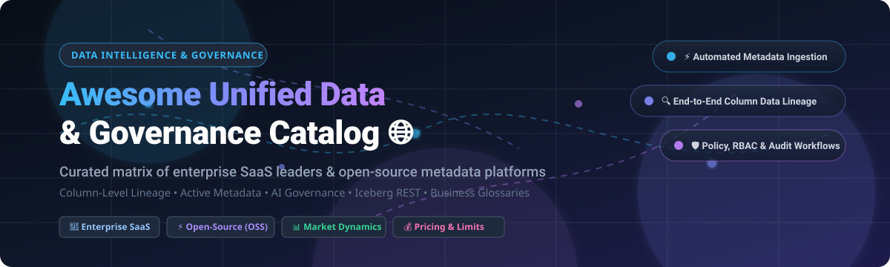

<p align="center">
  
</p>

# 🌐 Awesome Unified Data & Governance Catalog

<a href="https://github.com/ishandutta2007/Awesome-Awesome-Awesome"></a><a href="https://discord.gg/jc4xtF58Ve"></a>
[](https://github.com/ishandutta2007/Awesome-Awesome-Awesome)
[](https://opensource.org/licenses/MIT)
[](https://github.com/ishandutta2007/Awesome-Unified-Data-Governance-Catalog/graphs/commit-activity)
[](http://makeapullrequest.com)
<a href="https://github.com/ishandutta2007"></a>

> 🚀 **The definitive, SEO-optimized curated landscape and decision-making guide for Unified Data & Governance Catalogs, Active Metadata Management, Column-Level Data Lineage, and Enterprise Data Intelligence Platforms.**

---

## 📌 Table of Contents
- [📖 Overview & Key Capabilities](#-overview--key-capabilities)
- [📊 Sector Overview & Market Dynamics](#-sector-overview--market-dynamics)
- [🏢 Enterprise SaaS & Hosted Platforms](#-enterprise-saas--hosted-platforms)
- [⚡ Open-Source GitHub Projects](#-open-source-github-projects)
- [⚖️ Total Cost of Ownership (TCO) & Trade-offs](#-total-cost-of-ownership-tco--trade-offs)
- [💖 Support & Sponsorship](#-support--sponsorship)
- [⭐ Star History](#-star-history)
- [🤝 How to Contribute](#-how-to-contribute)
- [⚠️ Disclaimer](#-disclaimer)

---

## 📖 Overview & Key Capabilities

A **Unified Data & Governance Catalog** serves as the central command center for enterprise metadata, semantic data discovery, column-level data lineage, policy enforcement, access governance, and compliance auditability (GDPR, CCPA, BCBS 239, HIPAA). In modern data & AI architectures, data catalogs bridge technical assets (warehouses, lakehouses, orchestrators, BI dashboards, vector indexes) and business semantics (data products, glossaries, ownership, SLA monitoring, AI-ready datasets).

Key capabilities evaluated in this guide include:
- 🔍 **Automated Metadata Discovery & Profiling**: Automated crawlers and real-time push connectors across multi-cloud and on-prem storage engines.
- 🔗 **End-to-End Column-Level Lineage**: Query-log parsing (SQL dialect AST inspection) showing data provenance from source ingest to analytical BI reports.
- 🛡️ **Governance, RBAC & Policy Enforcement**: Tag-based access controls (TBAC), column masking, and row-level filtering synchronized with security engines (Ranger, Immuta, Privacera, Lakeformation).
- 🏷️ **Business Glossary & Semantic Data Products**: Domain ownership, glossary associations, data contract validations, and data quality metrics.
- 🤖 **AI-Ready Metadata & GenAI Agents**: Graph integration, Iceberg REST catalog compatibility, and Model Context Protocol (MCP) server support for AI agents.

---

## 📊 Sector Overview & Market Dynamics

The global enterprise data governance and data catalog software market is estimated at **$4.2 billion to $5.1 billion in 2026**, expanding at an aggressive compound annual growth rate (CAGR) of **~21.5%**, propelled by enterprise generative AI adoption, regulatory scrutiny over automated decisions, and the rise of data mesh paradigms. 

The sector displays a **moderately fragmented and bifurcated market structure** rather than a winner-take-all monopoly:
- **Cloud Hyperscalers & Lakehouse Giants** (Microsoft Purview, Snowflake Horizon, Databricks Unity Catalog) dominate basic telemetry, workload-native catalogs, and storage-tier security within their ecosystems.
- **Independent Best-of-Breed Governance Suites** (Collibra, Alation, Atlan, Informatica) maintain substantial moat across heterogeneous multi-cloud enterprises requiring vendor-neutral audit workflows, compliance sign-offs, and deep cross-platform glossaries.
- **Active Open-Source Ecosystems** (DataHub, OpenMetadata, Gravitino) command massive developer adoption for custom platform engineering and internal developer platform (IDP) integration.

---

## 🏢 Enterprise SaaS & Hosted Platforms

The table below catalogs leading commercial SaaS data intelligence platforms. The entries are sorted in descending order by company scale (market capitalization for publicly traded vendors, latest institutional valuation for venture-backed platforms).

| 🏢 Platform | 💰 Pricing (Specific Starting Tier) | 🎁 Free Tier / Free Trial Limits | 📈 Scale (Valuation / Revenue) | 🏷️ Key Differentiators |
| :--- | :--- | :--- | :--- | :--- |
| **[Microsoft Purview](https://www.microsoft.com/en-us/security/business/microsoft-purview)** | **$0.40 / Capacity Unit / hour** (~$292/month baseline for Governance domain + $0.63 per pay-as-you-go data map processing unit) | **Free Tier limited to basic metadata views**; 90-day free trial with **up to $300 Azure credits** & 4 capacity units | **$3.1+ Trillion Market Cap** (Microsoft parent) | Deep Microsoft 365, Fabric, Azure, and multi-cloud automated sensitivity classification; automated compliance posture scoring. |
| **[IBM Watson Knowledge Catalog](https://www.ibm.com/products/watson-knowledge-catalog)** | **$1,500 / month** (Cloud Pak for Data as a Service Starter tier; enterprise VPCs at ~$4.50/VPC hour) | **Lite Plan: 1 catalog, up to 50 assets, 1 user**, free forever with no credit card required | **$210+ Billion Market Cap** (IBM parent) | Embedded within IBM Cloud Pak for Data; enterprise automated policy enforcement, business terms, and AI model governance (watsonx.governance). |
| **[Snowflake Horizon Catalog](https://www.snowflake.com/)** | **~$2.00 - $4.00 per Snowflake Credit** (Standard $2.00, Enterprise $3.00, Business Critical $4.00 / credit; compute consumption based on warehouse size) | **30-day Free Trial with $400 of free usage credits**; includes full Horizon lineage and access policy features | **$55+ Billion Market Cap** (Snowflake Inc.) | Native governance layer inside Snowflake; unified discovery, column-level lineage, cross-cloud data sharing, and object tagging. |
| **[Databricks Unity Catalog](https://www.databricks.com/)** | **$0.07 - $0.55 per DBU** (Databricks Units depending on compute SKU: Serverless SQL $0.70/DBU, Jobs $0.15/DBU; Unity Catalog metastore management itself has $0 platform surcharge) | **14-day Free Trial with full platform access** and $0 Databricks platform fee (cloud provider infrastructure fees apply) | **$43+ Billion Valuation** ($2.4B+ ARR run-rate) | Universal governance across tables, files, volumes, and AI models; native Apache Iceberg REST support and credential vending. |
| **[Informatica CDGC](https://www.informatica.com/)** | **$2,500 / month base package** (Informatica Processing Units / IPU prepaid subscription model starting at ~10 IPUs/month) | **30-day Free Trial of IDMC** including Cloud Data Governance and Catalog with up to 10 automated scans | **$8+ Billion Market Cap** (~$1.6B annual revenue) | Intelligent Data Management Cloud (IDMC) integration with AI-powered CLAIRE engine; industry-standard data stewardship and compliance rules. |
| **[Quest erwin Data Catalog](https://www.quest.com/)** | **~$20,000 / year base subscription** (Licensed per data steward / metadata connectors, starting around ~$1,650/month) | **14-day Guided Free Evaluation / POC environment** with sample connector integrations (no public self-serve free forever tier) | **~$5 Billion Enterprise Valuation** (Quest Software / Clearlake) | Deep relational data modeling legacy (erwin Data Modeler), automated connector harvesting, and enterprise architectural lineage. |
| **[Collibra Data Intelligence](https://www.collibra.com/)** | **~$45,000 / year starting contract** (Base package starting ~$3,750/month covering platform foundation + per-user author/consumer licenses) | **No free forever tier**; **30-day guided enterprise sandbox / trial** provided through sales engagement | **$5.25 Billion Valuation** (~$250M+ ARR) | Gold-standard for Fortune 500 regulatory compliance (BCBS 239, GDPR); comprehensive stewardship operating models and business glossary. |
| **[Alation Data Catalog](https://www.alation.com/)** | **~$35,000 / year starting contract** (~$2,900/month baseline covering core catalog engine, 25 creator seats, and connectors) | **14-day Guided Free Sandbox Trial** with pre-populated enterprise data warehouse connections | **$1.7 Billion Valuation** (~$140M+ ARR) | Behavioral query log analysis (Behavioral Engine) to automatically rank trusted assets; collaborative SQL analytics and data curation. |
| **[Atlan Data Governance](https://atlan.com/)** | **$24,000 / year starting base tier** ($2,000/month for Atlan Starter tier including up to 15 users and 5 warehouse/BI integrations) | **14-day Free Trial with sample connectors** and full access to marketplace & lineage visualization | **$750 Million Valuation** (~$60M+ ARR) | Modern consumer-grade UX; active metadata automation via Slack/Teams/Chrome extensions, native dbt / Snowflake / Databricks integration. |
| **[data.world](https://data.world/)** | **$18,000 / year starting standard tier** ($1,500/month for Team/Standard tier; Enterprise custom tiers scale to $60k+/yr) | **Community Edition: Free forever for 3 open-source datasets & unlimited public sharing**; 14-day enterprise trial | **~$300 Million Valuation** (Series C venture-backed) | Built on an enterprise semantic knowledge graph (RDF/SPARQL); natural-language querying (Archie Bots) and data product catalogs. |

---

## ⚡ Open-Source GitHub Projects

Open-source data catalogs provide flexible architectures for organizations wanting full data ownership, extensible metadata schemas, and zero vendor lock-in. 

Repos below are sorted in descending order by **GitHub Star Count**:

| 📦 Repository & Project | ⭐ GitHub Stars | ⚖️ License | 🛠️ Architecture & Core Stack | 🎯 Ideal Use Case |
| :--- | :--- | :--- | :--- | :--- |
| **[OpenMetadata](https://github.com/open-metadata/OpenMetadata)** | [](https://github.com/open-metadata/OpenMetadata/stargazers) | Apache-2.0 | Java, Dropwizard, Elasticsearch, MySQL / PostgreSQL | **Best for teams seeking an all-in-one governance solution** featuring data quality tests, profiler, native Data Marketplace, MCP server, and data contracts without complex microservices. |
| **[DataHub](https://github.com/datahub-project/datahub)** | [](https://github.com/datahub-project/datahub/stargazers) | Apache-2.0 | Java, Python, Kafka, Elasticsearch, Neo4j / MySQL | **Best for high-throughput, real-time metadata streaming**, complex column-level lineage, enterprise event queues, and vector search embeddings for GenAI applications. |
| **[CKAN](https://github.com/ckan/ckan)** | [](https://github.com/ckan/ckan/stargazers) | AGPL-3.0 | Python, Flask, PostgreSQL, Apache Solr | **The world's leading open-source data portal platform**; battle-tested by national governments, municipal open data initiatives, and scientific institutions. |
| **[Amundsen](https://github.com/amundsen-io/amundsen)** | [](https://github.com/amundsen-io/amundsen/stargazers) | Apache-2.0 | Python, Flask, Neo4j / Apache Atlas, Elasticsearch | **Best for fast, search-first data discovery** across internal tables and BI dashboards when deep lineage and granular governance policies are handled externally. |
| **[Unity Catalog OSS](https://github.com/unitycatalog/unitycatalog)** | [](https://github.com/unitycatalog/unitycatalog/stargazers) | Apache-2.0 | Java, ANTLR, REST API, LF AI & Data Foundation | **Best for multi-engine lakehouse architectures** wanting standard Iceberg REST catalog compatibility, credential vending, and unified data/AI governance across engines (DuckDB, Spark, Trino). |
| **[Apache Gravitino](https://github.com/apache/gravitino)** | [](https://github.com/apache/gravitino/stargazers) | Apache-2.0 | Java, REST, Multi-catalog federation (Iceberg, Hive, MySQL) | **Best for federating multiple disparate catalogs** into a single metadata fabric without migrating legacy metastores wholesale. |
| **[Marquez](https://github.com/MarquezProject/marquez)** | [](https://github.com/MarquezProject/marquez/stargazers) | Apache-2.0 | Java, Dropwizard, PostgreSQL, OpenLineage standard | **Best for end-to-end data lineage collection and dataset health monitoring**; serves as the reference implementation for the Linux Foundation's OpenLineage standard. |
| **[Apache Atlas](https://github.com/apache/atlas)** | [](https://github.com/apache/atlas/stargazers) | Apache-2.0 | Java, HBase / Cassandra, JanusGraph, Apache Solr | **Best for Hadoop and legacy big-data estates** requiring tight integration with Apache Ranger for tag-based security access policies. |
| **[Apache Polaris](https://github.com/apache/polaris)** | [](https://github.com/apache/polaris/stargazers) | Apache-2.0 | Java, Quarkus, Apache Iceberg REST Specification | **Best for enterprise open lakehouses** needing vendor-neutral Apache Iceberg catalog management with centralized RBAC across Snowflake, Trino, Flink, and Spark. |
| **[Lakekeeper](https://github.com/lakekeeper/lakekeeper)** | [](https://github.com/lakekeeper/lakekeeper/stargazers) | Apache-2.0 | Rust, Axum, PostgreSQL | **Best for high-performance, ultra-lightweight Iceberg REST catalog hosting** with negligible resource footprint and rapid cold-boot times. |
| **[Magda](https://github.com/magda-io/magda)** | [](https://github.com/magda-io/magda/stargazers) | Apache-2.0 | TypeScript, Scala, Kubernetes-native, Elasticsearch | **Best for federated open data catalogs, spatial geospatial indexing, and public-sector data portals** with rich authorization policies. |

---

## ⚖️ Total Cost of Ownership (TCO) & Trade-offs

When choosing between commercial SaaS and self-hosted open-source governance catalogs, evaluate the hidden ongoing engineering overhead:

```
┌────────────────────────────────────────────────────────────────────────┐
│                        TCO Trade-off Spectrum                          │
├──────────────────────────────────┬─────────────────────────────────────┤
│      Open-Source (OSS)           │       Enterprise SaaS               │
├──────────────────────────────────┼─────────────────────────────────────┤
│ 🟢 $0 Software License Costs     │ 🔴 $18,000 - $60,000+ Annual Base   │
│ 🟢 Full Codebase Customization   │ 🔴 Locked Connector Ecosystem       │
│ 🟢 Complete Data/VPC Air-Gapping │ 🟢 Zero Cluster Maintenance Ops     │
│ 🔴 0.25 - 1.0 Dedicated FTE Eng  │ 🟢 Guaranteed Uptime SLA (99.9%+)   │
│ 🔴 Manual Query-Parser Patches   │ 🟢 Automated Compliance Evidence    │
│ 🔴 Connector Fragility on Schema │ 🟢 SOC2, HIPAA, FedRAMP Sign-offs   │
└──────────────────────────────────┴─────────────────────────────────────┘
```

> 💡 **Key Takeaway**: Self-hosting an open-source catalog saves upfront licensing fees, but requires ongoing operational commitments (~0.25 to 1.0 Platform Engineer FTE) to handle connector schema updates, search cluster re-indexing, Kafka streaming pipelines, and RBAC synchronization. Commercial SaaS is typically triggered when legal/compliance mandates demand external auditor approval logs and immutable records.

---

## 💖 Support & Sponsorship

Thank you so much for using and exploring the **Awesome Unified Data & Governance Catalog**! If this curated guide and market analysis helped you evaluate data governance platforms, choose metadata architectures, or save research time, please consider supporting the project:

- ⭐ **Star this repository** to help others discover it!
- 🍴 **Fork and share** it with your data engineering, governance, and architecture teams.
- ☕ **Support the maintainer**: You can buy a coffee or sponsor ongoing development via the [GitHub Sponsor Dashboard](https://github.com/sponsors/ishandutta2007).

[](https://github.com/sponsors/ishandutta2007)

---

## ⭐ Star History

[](https://star-history.dera.page/#ishandutta2007/Awesome-Unified-Data-Governance-Catalog&type=date&legend=top-left)

---

## 🤝 How to Contribute

Contributions are welcome! Please help keep this reference comprehensive and accurate:

1. 🍴 **Fork the repository** to your personal GitHub profile.
2. 🌿 **Create a descriptive feature branch** (`git checkout -b feature/add-new-catalog`).
3. 📝 **Add or update catalog entries** in `README.md` keeping formatting consistent with the existing tables.
4. 🔍 **Verify links and metrics** (pricing figures, free tier limits, star badges, and revenue estimates).
5. 🚀 **Submit a Pull Request** with a concise description of your additions.

---

## ⚠️ Disclaimer

- This repository is a **community-curated, educational index** and does not constitute commercial endorsement.
- Product pricing, features, free trials, and company valuations fluctuate; always verify with official vendor documentation and pricing pages.
- Access control mechanisms do not translate 1:1 between catalogs—migrating access policies between systems requires manual reconciliation.
